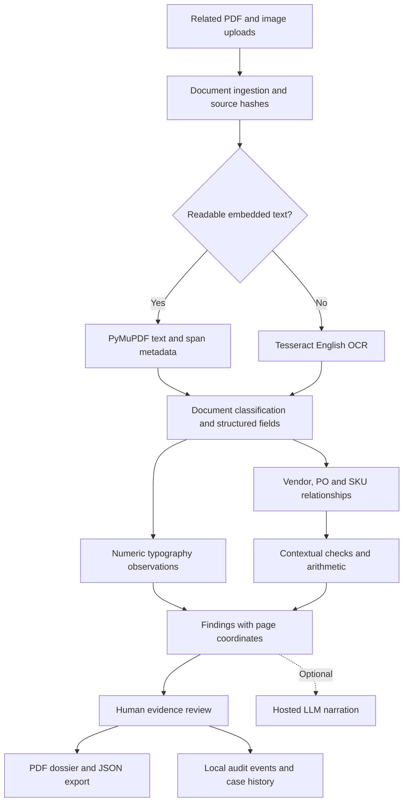

# Architecture

## Data and evidence contract

Each document has a generated ID, original display name, SHA-256 digest, detected type, pages, fields, SKU rows and warnings. Each page stores its coordinate width/height, rendered PNG, extraction method and text lines. Each field stores a value, page number, bounding box and OCR confidence where available. PDF-text confidence is null.

Each finding stores an ID, code, priority, observation status, explanation, next verification action, reviewer status and evidence references. Each reference identifies a document, page and bounding box. The UI scales boxes using source dimensions. The PDF generator uses the same references to crop supporting evidence. The original file hash establishes byte identity only; it does not establish provenance or authorship.

## Processing and AI roles

- PDF text and span metadata: PyMuPDF.
- Image recognition: Tesseract English OCR through the command-line executable.
- Classification: TF-IDF word/bigram features and logistic regression trained on a tiny in-repository example corpus, plus explicit headings. This is a prototype classifier, not a broadly validated model.
- Structure: labelled fields and SKU rows with numeric tail columns.
- Relationships: normalized vendor and PO identifiers; exact normalized SKU. No fuzzy multi-entity graph discovery.
- Context: line/subtotal/total arithmetic, PO unit-price differences, received-versus-invoiced quantity and vendor account comparison.
- Visual observations: numeric span size and font outliers in digital PDFs; limited OCR numeric-height outliers in raster pages. These are heuristic visual signals.
- Narration: optional OpenAI-compatible API. Existing findings remain authoritative. No autonomous tool loop, retrieval system or trained forgery detector is claimed.

## Storage

FastAPI serves static HTML/CSS/JS and the API from a single origin. Case folders contain originals, rendered pages and JSON. No external database is needed. Cases persist until deleted. The prototype runs as a local single-user application. Production would require authentication, encrypted storage, audit integrity controls and isolated processing workers.
